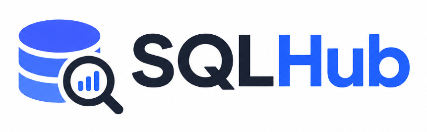

<div align="center">
  
  <p>Ask in natural language. Let your data answer.</p>
  <p>
    <a href="../README.md">中文</a> · English
  </p>
  <p>
    <a href="https://github.com/guomingkun8-a11y/sqlhub/stargazers"></a>
    <a href="https://github.com/guomingkun8-a11y/sqlhub/issues"></a>
  </p>
</div>

SQLHub is an AI-powered data analysis workspace for business teams. Ask questions in natural language: ordinary conversation gets a direct reply, while data questions query connected sources and return a written answer, a table, a chart, or a deeper investigation.

## What It Does

- **Conversation and data questions**: Handles greetings, general questions, data requests, and analytical follow-ups without requiring a fixed mode selection.
- **Results that fit the question**: Chooses a table or chart based on the request and query result, while respecting an explicit display request when possible.
- **Evidence-based investigation**: For trend and cause questions, the agent can run additional read-only queries and explain observed numbers, possible explanations, and what remains unverified.
- **Follow-up context**: Continues a conversation using earlier results from the same chat.
- **Controlled data access**: Checks user and workspace access, validates tables and columns, and enforces read-only SQL before execution. Configured data permission rules are applied to queries.
- **Business context**: Supports configurable terminology, SQL examples, and prompts to reflect an organization's language and metrics.
- **Multiple entry points**: Includes web chat, an MCP interface, and Feishu, DingTalk, and WeCom bots. Each bot queries as the linked user and sends group-query results privately to the requester.

## How It Works

SQLHub first decides whether a message needs datasource access. General conversation does not execute SQL. A data request uses the datasource in the current chat or selects an available datasource in the current workspace. Queries pass access checks and read-only validation before execution. The model then writes an answer grounded in the returned evidence. Investigation is bounded by query-count and result-size limits.

## Repository Layout

| Path | Contents |
| --- | --- |
| `backend/` | FastAPI service, data access, safe queries, agent workflow, and migrations |
| `frontend/` | Vue 3 web application |
| `g2-ssr/` | Server-side chart rendering |
| `installer/` | Installation and service-management resources |
| `docs/` | Development and maintenance documentation |

## Development

The backend uses Python 3.11 and the frontend uses Node.js. Prepare PostgreSQL and configure the model, database, and other required services before starting the application.

```powershell
cd backend
uv sync
uv run uvicorn main:app --host 0.0.0.0 --port 8000 --workers 1
```

In a separate terminal, start the frontend:

```powershell
cd frontend
npm ci
npm run dev -- --host 0.0.0.0 --port 3333
```

Run backend tests with:

```powershell
cd backend
uv run pytest -q
```

## License

This project is licensed under GPLv3 with additional conditions. Read the repository's [LICENSE](../LICENSE) before using, modifying, or distributing the code.
